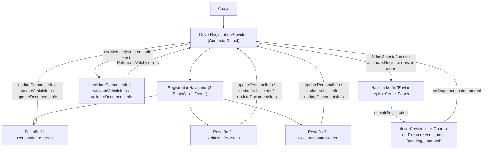

# Guía Completa de Sustentación — UberClone (Versión Conductor)

Este documento explica a fondo **cómo funciona el proyecto**, **por qué se tomaron las decisiones técnicas de arquitectura** y un **banco de preguntas y respuestas** frecuentes que puede hacer la profesora durante la sustentación.

---

## 1. Resumen General de lo Implementado

Hasta este punto, la aplicación implementa el **Módulo Completo de Registro y Verificación del Conductor**, dividido en **3 pestañas** mediante navegación por `Bottom Tabs` (`@react-navigation/bottom-tabs`), con un **pie de página fijo (Footer)** que controla el envío definitivo hacia **Firebase Firestore**:

1. **Pestaña 1 — Datos Personales (`PersonalInfoScreen.jsx`)**: Foto de perfil, nombre completo (con soporte de tildes), documento de identidad, celular, fecha de nacimiento (mayor de 18 años), género y correo electrónico.
2. **Pestaña 2 — Información del Vehículo (`VehicleInfoScreen.jsx`)**: Categoría (`Económico`, `XL`, `Premium`), placa colombiana (`ABC123`), marca, modelo, año, color, capacidad de pasajeros (con validación cruzada para `XL >= 6`) y foto exterior del vehículo.
3. **Pestaña 3 — Documentos y Pagos (`DocumentsInfoScreen.jsx`)**: Licencia de conducción (número, foto y vencimiento), SOAT (foto y vencimiento), Revisión técnico-mecánica (condicional según el año del vehículo), correo de Mercado Pago y aceptación obligatoria de términos con el porcentaje de comisión (`20 %`) visible.

---

## 2. Arquitectura de Carpetas y Por Qué se Hizo Así

La estructura sigue el patrón visto en clase (carpeta `Examples` y `ExamplesServicesBd.js`), aplicando el principio de **Separación de Responsabilidades (*Separation of Concerns*)**:

```text
src/
├── config/
│   ├── firebaseConfig.js         # Inicialización de Firebase (db y storage)
│   ├── appConfig.js              # Interruptor USE_FIREBASE_STORAGE (local vs nube)
│   └── pricing.js                # Tarifa base, multiplicadores y comisión (20%)
├── constants/
│   └── storageKeys.js            # Claves únicas de AsyncStorage (@uberclone_driver_session)
├── data/
│   ├── registrationData.js       # Estados iniciales vacíos de las 3 pestañas
│   └── registrationOptions.js    # Opciones de listas desplegables (género, categoría, color)
├── services/
│   ├── driverService.js          # Operaciones CRUD y tiempo real con Firestore ('drivers')
│   ├── imageStorageService.js    # Subida opcional de fotos a Firebase Storage
│   └── localStorageService.js    # Funciones saveData, getData, removeData con AsyncStorage
├── context/
│   └── DriverRegistrationContext.js # Estado global de las 3 pestañas, validaciones y envío
├── hooks/
│   └── useDriverRegistration.js  # Custom hook para consumir el contexto fácilmente
├── utils/
│   ├── dateUtils.js              # Manejo de fechas locales sin desfase de zona horaria
│   └── registration/
│       ├── validatePersonalInfo.js   # Función pura de validación Pestaña 1
│       ├── validateVehicleInfo.js    # Función pura de validación Pestaña 2
│       └── validateDocumentsInfo.js  # Función pura de validación Pestaña 3
├── components/
│   └── registration/
│       ├── FieldMessage.jsx      # Muestra errores en rojo debajo de cada campo (sin Alert)
│       ├── FormInput.jsx         # Input de texto reutilizable
│       ├── FormSelect.jsx        # Lista desplegable en Modal reutilizable
│       ├── DatePickerField.jsx   # Selector de fecha nativo (Android/iOS)
│       ├── ImagePickerField.jsx  # Selector de cámara y galería con vista previa
│       └── CheckboxField.jsx     # Checkbox reutilizable para términos y comisión
├── screens/
│   └── registration/
│       ├── PersonalInfoScreen.jsx    # Pantalla Pestaña 1
│       ├── VehicleInfoScreen.jsx     # Pantalla Pestaña 2
│       └── DocumentsInfoScreen.jsx   # Pantalla Pestaña 3
├── navigation/
│   └── RegistrationNavigator.js  # Bottom Tabs + Footer con botón "Enviar registro"
└── theme/
    ├── index.js                  # Paleta verde, espaciados, bordes, tipografía y sombras
    └── theme.js                  # Re-exportación para compatibilidad de rutas
```

### ¿Por qué esta separación es ideal para sustentar?
* **Las pantallas (`screens/`) solo dibujan interfaz:** No tienen lógica compleja de Firebase ni expresiones regulares adentro.
* **Las validaciones (`utils/registration/`) son funciones puras:** Reciben un objeto con datos y devuelven `{ isValid, errors }`. Se pueden probar de forma aislada sin siquiera abrir el emulador.
* **Los servicios (`services/`) encapsulan a Firebase y AsyncStorage:** Si mañana cambia la colección de Firebase, solo se edita `driverService.js` y ninguna pantalla se rompe.

---

## 3. Flujo de Funcionamiento Paso a Paso



1. **Inicio de la App (`App.js`)**: Envuelve toda la aplicación en `<DriverRegistrationProvider>`. Al arrancar, un `useEffect` revisa en `AsyncStorage` si había un `driverId` guardado. Si existe, descarga sus datos desde Firestore (`getDriver`) y rellena el formulario automáticamente.
2. **Escritura y Validación Reactiva**:
   - Cuando el conductor escribe en cualquier campo (ej. `fullName`), se llama a `updatePersonalInfo('fullName', text)` y `touchField('fullName')`.
   - El estado `personalInfo` cambia, lo que dispara automáticamente el `useMemo` que ejecuta `validatePersonalInfo(personalInfo)`.
   - ¿Por qué existe `touchedFields`? Para **no mostrar todos los campos en rojo apenas el usuario abre la aplicación por primera vez**. El error de un campo solo se muestra debajo de él cuando el usuario ya lo tocó (`touchedFields[campo] === true`) o cuando intentó avanzar de pestaña / enviar el formulario.
3. **Habilitación del Botón "Enviar registro"**:
   - El botón vive en `RegistrationNavigator.js`, **por fuera** del `<Tab.Navigator>`, para que sea visible sin importar en cuál de las 3 pestañas esté parado el usuario.
   - Su propiedad `disabled` depende de `!isRegistrationValid || isSaving`.
   - `isRegistrationValid` es `true` **únicamente** cuando `isPersonalInfoValid && isVehicleInfoValid && isDocumentsInfoValid` son `true` al mismo tiempo.
4. **Envío a Firebase y Cambio de Estado**:
   - Al presionar **"Enviar registro"**, `persistRegistration` verifica en Firestore que no exista otro conductor con esa misma cédula (`getDriver`) ni con esa misma placa (`findDriverByLicensePlate`).
   - Guarda el documento en la colección `drivers` usando el número de documento (`documentId`) como ID del documento en Firestore, con `status: 'pending_approval'`.
   - Inmediatamente se activa un `useEffect` con `subscribeToDriver` (`onSnapshot`). Si la profesora entra a Firebase Console y cambia el campo `status` de `"pending_approval"` a `"approved"`, la app del celular cambia en vivo a un cartel verde que dice **"Estado: Aprobado"** sin necesidad de recargar la app.

---

## 4. Uso de Hooks Obligatorios (Punto Clave de Evaluación)

La especificación exige el uso justificado de los hooks vistos en clase. Así están aplicados en nuestro código:

| Hook | Dónde se usa | Para qué se usa exactamente |
| :--- | :--- | :--- |
| **`useState`** | `DriverRegistrationContext.js`, `FormInput.jsx`, `FormSelect.jsx`, `DatePickerField.jsx`, `ImagePickerField.jsx` | Guardar los datos de las 3 pestañas (`personalInfo`, `vehicleInfo`, `documentsInfo`), los campos tocados (`touchedFields`), el estado de carga (`savingAction`), y la apertura/cierre de modales en selectores. |
| **`useEffect` (con limpieza)** | `DriverRegistrationContext.js` (líneas 98 y 131) | **1)** Cargar la sesión inicial desde `AsyncStorage` + Firestore usando una bandera `let isActive = true` en la limpieza para evitar actualizar estado si el componente se desmonta.<br>**2)** Suscribirse en tiempo real al documento del conductor en Firestore con `onSnapshot`, retornando `return () => unsubscribe()` para evitar fugas de memoria (*memory leaks*). |
| **`useContext`** | `useDriverRegistration.js` y `DriverRegistrationContext.js` | Compartir el estado de las 3 pestañas entre las pantallas y el navegador sin pasar *props* manualmente (*prop drilling*). |
| **`useMemo`** | `DriverRegistrationContext.js` (líneas 176-188 y 354) | Memorizar el resultado de las validaciones de cada pestaña (`validatePersonalInfo`, `validateVehicleInfo`, `validateDocumentsInfo`) y el objeto `value` del contexto. Si el usuario escribe en la Pestaña 1, **no** se re-ejecuta la validación de la Pestaña 2. |
| **`useCallback`** | `DriverRegistrationContext.js`, `FormSelect.jsx`, `DatePickerField.jsx`, `ImagePickerField.jsx` | Memorizar las funciones actualizadoras (`updatePersonalInfo`, `submitRegistration`, `saveDraft`, `pickImage`) para que mantengan la misma referencia en memoria entre renderizados. |
| **Custom Hook** | `src/hooks/useDriverRegistration.js` | Encapsular `useContext(DriverRegistrationContext)` y validar que siempre se llame dentro del Provider. |

---

## 5. Detalles Técnicos Importantes que Debes Conocer

### A. ¿Por qué creamos `parseLocalDate` en `src/utils/dateUtils.js`?
En JavaScript, si haces `new Date("2008-11-05")`, el motor lo interpreta en hora **UTC (Londres, 00:00)**. Como en Colombia estamos en **UTC-5**, esa fecha se convierte internamente en el **4 de noviembre a las 7:00 p. m.** (¡un día antes!).
Con `parseLocalDate`, separamos año, mes y día y llamamos a `new Date(year, month - 1, day)`, que crea la fecha en la hora local exacta del teléfono sin restarle un día.

### B. ¿Cómo funciona la validación cruzada en la Pestaña 2 (Vehículo)?
En `validateVehicleInfo.js`, la regla dice que la capacidad de pasajeros depende de la categoría elegida:
- Si `category === 'xl'`, el mínimo exigido es **6 pasajeros** (`MIN_CAPACITY_BY_CATEGORY.xl = 6`).
- Además, en `VehicleInfoScreen.jsx` (`handleCategoryChange`), si el conductor ya había escrito `4` pasajeros en categoría `Económico` y luego cambia el selector a `XL`, marcamos `passengerCapacity` como tocado inmediatamente para que le aparezca el error enseguida.

### C. ¿Cómo funciona la validación cruzada en la Pestaña 3 (Técnico-mecánica)?
La especificación indica: *"Revisión técnico-mecánica: Foto + fecha de vencimiento (si aplica según el año del vehículo)"*.
- En `validateDocumentsInfo.js`, la función `doesVehicleRequireMechanicalInspection(vehicleInfo.year)` calcula `añoActual - añoVehículo`.
- Si el vehículo tiene **5 o más años de antigüedad** (norma colombiana), la foto y la fecha de vencimiento de la técnico-mecánica son **obligatorias**.
- Si el vehículo tiene **menos de 5 años** (ej. modelo 2024, 2025 o 2026), la pantalla muestra un aviso verde indicando que está **exento** y permite enviar el registro sin adjuntarla.

---

## 6. Posibles Preguntas de la Profesora y Cómo Responderlas

### Pregunta 1: *"¿Por qué no usaron `Alert.alert` para mostrar los errores de validación o permisos de cámara?"*
> **Respuesta:**  
> "Porque la especificación técnica prohíbe expresamente el uso de `Alert` para errores de formulario y exige que se muestren debajo de cada campo. Por eso creamos el componente reutilizable `FieldMessage.jsx`, que todos los inputs (`FormInput`, `FormSelect`, `DatePickerField`, `ImagePickerField` y `CheckboxField`) renderizan en la parte inferior cuando reciben la prop `error`. Incluso si el usuario niega el permiso de cámara o galería, `ImagePickerField` captura ese estado en `pickerError` y lo muestra debajo de la foto en lugar de lanzar un `Alert`."

---

### Pregunta 2: *"¿Cómo logran que el botón 'Enviar registro' sepa en tiempo real si las 3 pestañas están listas?"*
> **Respuesta:**  
> "Porque el estado de las tres pestañas no vive aislado dentro de cada pantalla, sino centralizado en `DriverRegistrationContext.js`. Cada vez que un campo cambia en cualquiera de las tres pestañas, `useMemo` evalúa `validatePersonalInfo`, `validateVehicleInfo` y `validateDocumentsInfo`. El contexto calcula la variable booleana `isRegistrationValid = isPersonalInfoValid && isVehicleInfoValid && isDocumentsInfoValid`. Como `RegistrationNavigator.js` consume ese contexto, el botón del pie de página se habilita automáticamente en el instante en que las tres validaciones dan `true`."

---

### Pregunta 3: *"¿Por qué usaron `useMemo` para las validaciones en vez de ejecutarlas como variables normales?"*
> **Respuesta:**  
> "Por rendimiento y por requisito de la rúbrica. En un formulario grande con 3 pestañas y más de 20 campos, si el usuario está escribiendo su nombre letra por letra en la Pestaña 1, no tiene sentido volver a validar la placa, el año del vehículo ni las fechas de vencimiento de los documentos en cada pulsación de tecla. Con `useMemo([personalInfo])`, React solo recalcula la validación de la pestaña cuyo estado realmente cambió."

---

### Pregunta 4: *"¿Cómo evitaron fugas de memoria (memory leaks) al conectarse con Firebase?"*
> **Respuesta:**  
> "En `DriverRegistrationContext.js`, cuando el registro se envía, abrimos una suscripción en tiempo real a Firestore con `onSnapshot` (mediante `subscribeToDriver` en `driverService.js`). Esa función devuelve el método `unsubscribe`. Dentro del `useEffect`, retornamos la función de limpieza `return () => unsubscribe()`, lo que garantiza que cuando el componente se desmonte o cambie el `driverId`, el listener de Firebase se cierre inmediatamente."

---

### Pregunta 5: *"¿Cómo evitan que un conductor se registre dos veces con la misma cédula o que dos conductores registren la misma placa?"*
> **Respuesta:**  
> "En `driverService.js` implementamos dos controles antes de guardar:
> 1. Usamos el número de documento (`documentId`) como ID del documento en la colección `drivers` de Firestore (`doc(db, 'drivers', driverId)`), verificando primero con `getDriver` si ya existe un registro enviado con esa cédula.
> 2. Ejecutamos una consulta `findDriverByLicensePlate` con `where('vehicleInfo.licensePlate', '==', licensePlate)` para verificar que ningún otro documento en la colección tenga asignada esa placa."

---

### Pregunta 6: *"¿Por qué las fotos se guardan con una ruta `file://` y qué hace `USE_FIREBASE_STORAGE`?"*
> **Respuesta:**  
> "En la sección 7 de la especificación se advierte que Firebase Storage en proyectos nuevos exige pasar al plan de pago Blaze con tarjeta de crédito. Para que el proyecto sea 100% funcional en el plan gratuito sin bloqueos, `expo-image-picker` almacena la imagen comprimida en el sistema de archivos interno del dispositivo (`file:///...`) y guardamos esa URI en Firestore, la cual el componente `<Image />` de React Native renderiza directamente. Además, dejamos lista toda la integración con Firebase Storage en `imageStorageService.js` controlada por la constante `USE_FIREBASE_STORAGE` en `appConfig.js`."

---

### Pregunta 7: *"¿Qué guardan en `AsyncStorage` y por qué?"*
> **Respuesta:**  
> "Cumpliendo la regla de seguridad del proyecto, en `AsyncStorage` (`localStorageService.js`) jamás guardamos tarjetas, cuentas ni información sensible. Únicamente guardamos `{ driverId }` bajo la clave `@uberclone_driver_session`. Así, cuando el conductor cierra y vuelve a abrir la aplicación, la app recuerda quién es y descarga su estado actual (`draft`, `pending_approval` o `approved`) directamente desde Firestore."

