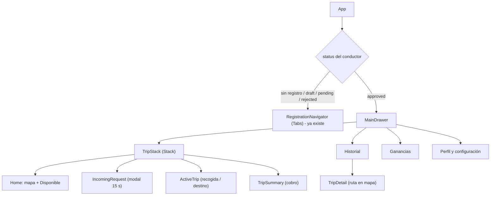
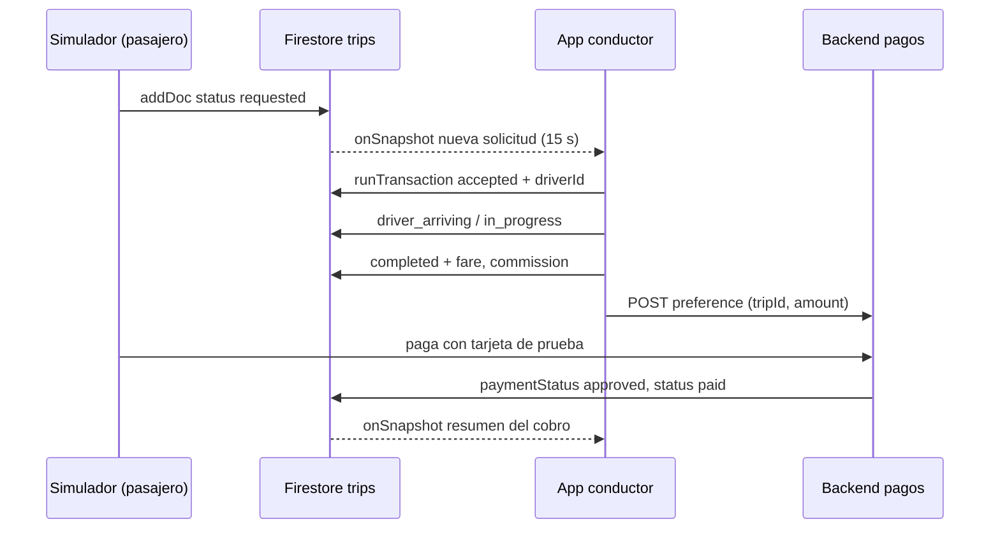

# Plan de trabajo — UberClone Conductor (lo que falta)

## 0. Estado actual

| Módulo de la especificación | Estado |
|---|---|
| Registro en 3 Tabs + validaciones + `pending_approval` en Firestore | ✅ Hecho |
| Sesión en AsyncStorage + escucha del `status` con `onSnapshot` | ✅ Hecho |
| `src/config/pricing.js` | ✅ Hecho (`calculateFare` listo) |
| Inicio con mapa + interruptor Disponible / No disponible + GPS | ✅ Hecho |
| Solicitud entrante con temporizador de 15 s | ✅ Hecho |
| Viaje en curso (Stack: recogida → destino → finalizar) | ✅ Hecho |
| Cobro (Mercado Pago de prueba + efectivo) y resumen | ✅ Hecho (Backend Express + Checkout Pro + Webhook + Saldo) |
| Drawer: Perfil/Configuración, Historial, Ganancias | ❌ |
| Hooks `useDriverLocation`, `useTripRequests`, `useEarnings` | 🟡 `useDriverLocation` y `useTripRequests` listos (falta `useEarnings`) |
| Notificaciones de nuevas solicitudes | ❌ |
| README, `.env.example`, `docs/AI_LOG.md` unificado, video | ❌ |

> [!WARNING]
> **Navegación:** `AGENTS.md` pide Expo Router, pero el proyecto ya usa **React Navigation** y la especificación pide explícitamente *Stack + Tabs + Drawer*. Recomiendo **seguir con React Navigation** (agregar `@react-navigation/drawer`) para no rehacer el registro. Conviene actualizar `AGENTS.md` para que no haya contradicción.

---

## 1. Arquitectura de navegación objetivo



La pantalla visible dentro de `TripStack` la decide el campo `status` del viaje activo (`accepted`/`driver_arriving` → ActiveTrip, `in_progress` → ActiveTrip a destino, `completed` → TripSummary esperando pago, `paid` → resumen final).

---

## 2. Fases de trabajo

> [!IMPORTANT]
> **Proyecto individual (solo Santiago).** Las fases van en orden secuencial: cada una deja algo probable antes de pasar a la siguiente. El simulador se construye **al principio** porque sin él no se pueden probar las fases 3 a 5.

### Flujo de Git para una persona
- Rama de trabajo única: `santiago` (o ramas cortas `feature/...` que salen de ella).
- Al terminar cada fase: commit(s) → **Pull Request `santiago` → `main`** → merge. La rúbrica pide PRs revisados, así que haz al menos un PR por fase con una descripción clara (sirve como evidencia aunque lo revises tú).
- Bitácora: un solo archivo, `docs/AI_LOG.md` (mover ahí el contenido de `BITACORA SANTIAGO.md`).

### Fase 1 — Base + simulador (≈3 días)
- `src/utils/calculateFare.js` (función pura) + prueba con el ejemplo 8,5 km / 22 min (Económico 19.200 / XL 26.900).
- `src/constants/tripStatus.js` (estados del viaje, métodos y estados de pago con etiquetas en español).
- `src/services/tripService.js`: `subscribeToRequestedTrips`, `acceptTrip` (con **`runTransaction`** para no aceptar un viaje ya tomado o cancelado), `rejectTrip`, `updateTripStatus`, `completeTrip`, `markCashPaid`.
- **`scripts/simulatePassenger.mjs`** (ver sección 3): `approve`, `request`, `loop`, `cancel`, `pay`, `rate`, `seed`, `clear`.
- `src/context/ActiveTripContext.js` (viaje activo + disponibilidad) con `useContext`.
- `src/navigation/RootNavigator.js` que elige Registro o Drawer según `registrationStatus === 'approved'`.
- Instalar: `npx expo install @react-navigation/drawer react-native-gesture-handler react-native-reanimated`.

### Fase 2 — Inicio, ubicación y disponibilidad (≈2 días)
- `npx expo install expo-location react-native-maps` (verificar en la doc de **SDK 58** la configuración de API key de Google Maps en `app.json`).
- `useDriverLocation(isAvailable)`: `Location.watchPositionAsync` con limpieza (`subscription.remove()`), escribe `currentLocation` en `drivers/{id}` cada ~5 s.
- `HomeScreen`: mapa + interruptor. Bloquear el interruptor si `status !== 'approved'`. Guardar último estado de disponibilidad en AsyncStorage.

### Fase 3 — Solicitudes y viaje (≈3 días)
- `useTripRequests({ driverId, category, isAvailable })`: `onSnapshot` sobre `trips` con `status == 'requested'` y `category == categoría del conductor`; filtra los que el conductor ya rechazó.
- `IncomingRequestScreen`: tarjeta (origen, destino, distancia, duración, categoría, método de pago, tarifa y ganancia neta estimada con `calculateFare`) + temporizador 15 s con `setInterval` y `clearInterval` en la limpieza; a 0 → `rejectTrip` automático. Aceptar/Rechazar con `useCallback`.
- `ActiveTripScreen`: ruta hacia recogida → botón **"Pasajero a bordo"** (`in_progress`) → ruta a destino → **"Finalizar viaje"** (`completed`, guarda `fare`, `commission`, `driverEarnings`, `commissionRate`, `completedAt`).
- Rutas: Google Directions **una sola vez** al aceptar y otra al pasar a bordo (o OSRM gratuito como alternativa); dibujar con `Polyline`.

### Fase 4 — Pagos (≈2–3 días)
- **Backend mínimo** (`/backend`, Node + Express, o Firebase Cloud Functions): `POST /payments/preference` con `{ tripId, amount }` → crea preferencia de Checkout Pro con `MP_ACCESS_TOKEN` del `.env`; `POST /payments/webhook` → actualiza `paymentStatus`, `paymentId`, `status: 'paid'`.
- `TripSummaryScreen`: escucha el viaje con `onSnapshot`; muestra tarifa, comisión, ganancia y estado (Aprobado / Pendiente / Rechazado / Efectivo). Botón **"Cobro en efectivo recibido"**.
- Saldo del conductor: ganancias de viajes por pasarela − comisiones de viajes en efectivo (puede ser negativo).

### Fase 5 — Drawer: Historial, Ganancias, Perfil (≈3 días)
- `HistoryScreen`: `FlatList`, `orderBy('createdAt','desc')`, `limit(20)` + `startAfter` para paginar; filtros Hoy / Semana / Mes / Rango y método de pago; mensaje vacío. `TripDetailScreen` con ruta guardada en `Polyline`, distancia, duración, comisión, propina y calificación.
- `useEarnings(trips)` + `EarningsScreen`: con `useMemo` por hoy/semana/mes → nº viajes, total facturado, comisiones, propinas, neto, promedio y saldo.
- `ProfileScreen`: datos editables (reusar componentes de registro), vehículo, documentos, **cerrar sesión** (borra `DRIVER_SESSION`).
- Índices compuestos de Firestore que pedirá la consola (p. ej. `driverId + createdAt`).

### Fase 6 — Notificaciones, entrega y pulido (≈2 días)
- Notificación de nueva solicitud: `expo-notifications` (notificación local disparada desde el listener) es lo viable en Expo; FCM real con `@react-native-firebase/messaging` exige *development build*. Documentar la decisión en la bitácora.
- Mover config de Firebase a variables `EXPO_PUBLIC_*` + `.env.example`; reglas de seguridad de Firestore.
- README (instalación, `.env.example`, sección "Uso de IA"), bitácora `docs/AI_LOG.md` exportada a PDF, video ≤ 5 min.
- `npx expo lint`, `npx expo-doctor` antes de cada PR.

### Resumen de tiempos (una persona)

| Orden | Fase | Esfuerzo | Entregable probable al terminar |
|---|---|---|---|
| 1 | Base + simulador | ≈3 días | Crear solicitudes desde la terminal y verlas en Firestore |
| 2 | Inicio + GPS | ≈2 días | Mapa con ubicación, Disponible / No disponible |
| 3 | Solicitudes + viaje | ≈3 días | Flujo completo hasta `completed` con el simulador |
| 4 | Pagos | ≈2–3 días | Cobro en efectivo y Mercado Pago de prueba (`paid`) |
| 5 | Drawer | ≈3 días | Historial, Ganancias y Perfil (con datos de `seed`) |
| 6 | Entrega | ≈2 días | README, bitácora PDF, video |
| | **Total** | **≈15–16 días** | |

> [!TIP]
> Si el tiempo no alcanza, recorta en este orden: notificaciones locales → filtro por rango de fechas → edición del perfil. Lo que **no** se debe recortar: temporizador de 15 s, `calculateFare`, cobro en efectivo, historial y ganancias (aparecen en el video obligatorio).

---

## 3. Cómo simular las solicitudes (sin app del pasajero)

La idea clave: **el conductor solo lee y actualiza documentos en `trips`**. Cualquier cosa que cree un documento con `status: 'requested'` actúa como "pasajero". Así la app del conductor usa el flujo real (`onSnapshot`) y la simulación queda fuera de su lógica.

### Modelo del documento que crea el simulador
```js
{
  passengerId: 'sim_passenger_01',
  passengerName: 'Laura Gómez',
  driverId: null,
  rejectedBy: [],
  origin: { lat: 6.2442, lng: -75.5812, address: 'Parque Berrío, Medellín' },
  destination: { lat: 6.2006, lng: -75.5783, address: 'El Poblado, Medellín' },
  distanceKm: 8.5,
  durationMin: 22,
  category: 'economy',
  paymentMethod: 'mercadopago', // o 'cash'
  tip: 0,
  status: 'requested',
  createdAt: serverTimestamp(),
}
```

### Opción A — Script de Node "pasajero simulado" (recomendada)
`scripts/simulatePassenger.js` usando el mismo SDK `firebase` (ya instalado):

```bash
node scripts/simulatePassenger.js request --category economy --payment cash
node scripts/simulatePassenger.js request --near 6.2442,-75.5812   # cerca del conductor
node scripts/simulatePassenger.js loop --every 30                   # una solicitud cada 30 s
node scripts/simulatePassenger.js cancel <tripId>                   # pasajero cancela
node scripts/simulatePassenger.js pay <tripId> --status approved    # simula el webhook
node scripts/simulatePassenger.js rate <tripId> 5
node scripts/simulatePassenger.js seed --driver <driverId> --count 60  # historial falso del mes
node scripts/simulatePassenger.js approve <driverId>                # pasa el conductor a 'approved'
```
- Origen/destino aleatorios desde una lista de lugares de Medellín, o generados alrededor de `drivers/{id}.currentLocation`.
- Distancia con Haversine × 1,3 y duración a ~25 km/h (o una llamada real a Distance Matrix al crear la solicitud, como pide la especificación).
- **Ventaja:** se ve en el video como un "pasajero" externo y el código del conductor queda limpio.

### Opción B — Botón "Simular solicitud" dentro de la app (solo en desarrollo)
- Visible solo con `__DEV__` o una bandera `ENABLE_TRIP_SIMULATOR` en `appConfig.js`.
- Llama a `createSimulatedTrip(currentLocation, category)` que hace el mismo `addDoc`. Útil para probar en el celular sin computador.

### Opción C — Consola de Firebase
Crear el documento a mano en `trips`. Sirve para depurar un caso puntual, no para la demo.

### Simular el resto del flujo
| Qué | Cómo |
|---|---|
| Aprobación del conductor | Cambiar `status` a `approved` en la consola o `script approve` |
| Movimiento del GPS | Emulador Android → *Extended controls → Location → Routes* (o cargar un GPX). En dispositivo físico: modo demo que interpola la posición sobre la `Polyline` |
| Rechazo / tiempo agotado | Se agrega el `driverId` a `rejectedBy` (o `status: 'rejected'` si es el único conductor) |
| Cancelación del pasajero | `script cancel` → la app ve `cancelled` y vuelve al inicio |
| Pago con tarjeta | Real: Checkout Pro de prueba con comprador de prueba. Sin backend aún: `script pay --status approved/rejected/pending` |
| Historial y ganancias | `script seed` con fechas repartidas en hoy, semana y mes, mezclando `cash` y `mercadopago` |



---

## 4. Preguntas abiertas
1. ¿Cuál es la **fecha de entrega**? Ajusto las fases a un calendario real (≈15 días de trabajo para una persona).
2. ¿Prefieren **Express** o **Cloud Functions** para el backend de pagos? (Cloud Functions también requiere plan Blaze).
3. Idioma: la especificación menciona selector Español/Inglés, pero la skill del proyecto dice solo español. ¿Lo confirmó el profesor?
4. ¿Google Directions (requiere API key con facturación) u OSRM gratuito para las rutas?
